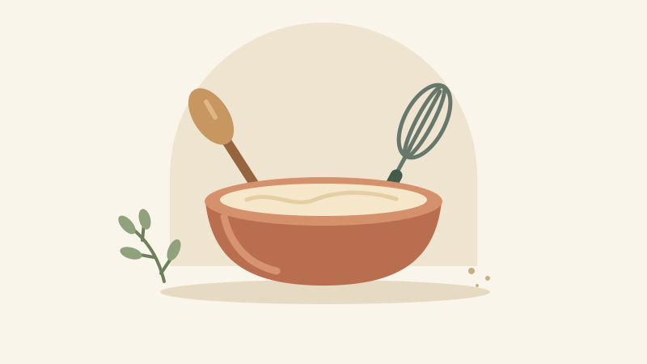

# Cooking & Baking Recipes

A small recipe box for Davide's pizza and tiramisu, plus vanilla cheesecake. Open a recipe for its ingredients and method; everything is readable directly on GitHub.

## Pick a recipe

| Recipe | What to expect | Planning ahead |
| --- | --- | --- |
| [Davide's Pizza](cooking/davides-pizza.md) | Yeasted dough, tomato, mozzarella and your own toppings; written for three people | Two-hour dough rest, followed by a two-stage bake |
| [Classic Baked Vanilla Cheesecake](baking/classic-baked-vanilla-cheesecake.md) | Shortcrust pastry with a vanilla cream cheese filling | Chill the pastry for 30–45 minutes before assembly |
| [Davide's Tiramisu](baking/tiramisu.md) | Ricotta and mascarpone cream, coffee-soaked savoiardi, and Disaronno or Marsala | Refrigerate for at least two hours before serving |

## A look inside

[Davide's tiramisu guide](baking/tiramisu.md) includes ingredient reference photos, a layer diagram and a scaling table.

## Recipe notes

Start with the quantities in each recipe. The tiramisu source leaves some amounts unspecified; those gaps are identified in the guide rather than filled with estimates.

The pizza and cheesecake recipes retain their original text and Git histories. The tiramisu recipe is presented as GitHub Markdown, with ingredient photos, a biscuit-layer diagram, and scaling guidance.

## License

The original pizza and cheesecake recipes use [CC0 1.0 Universal](LICENSE). Tiramisu ingredient photos retain their individual licenses; see the [image credits](baking/tiramisu.md#image-credits). The source tiramisu recipe does not state a license.
