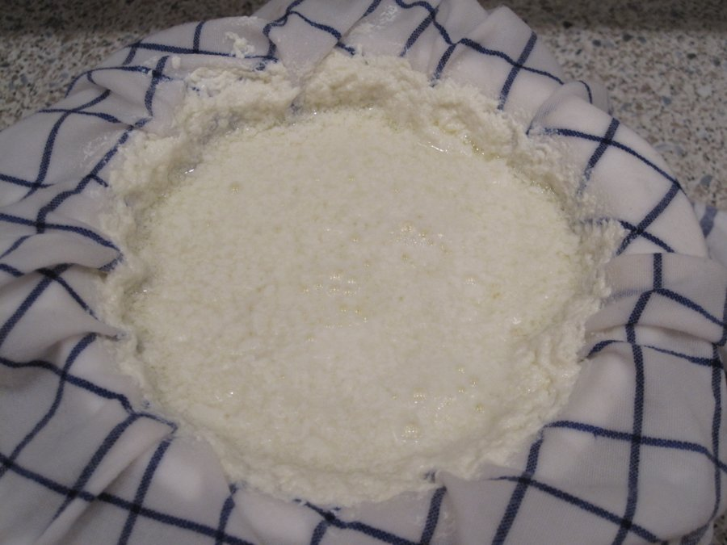
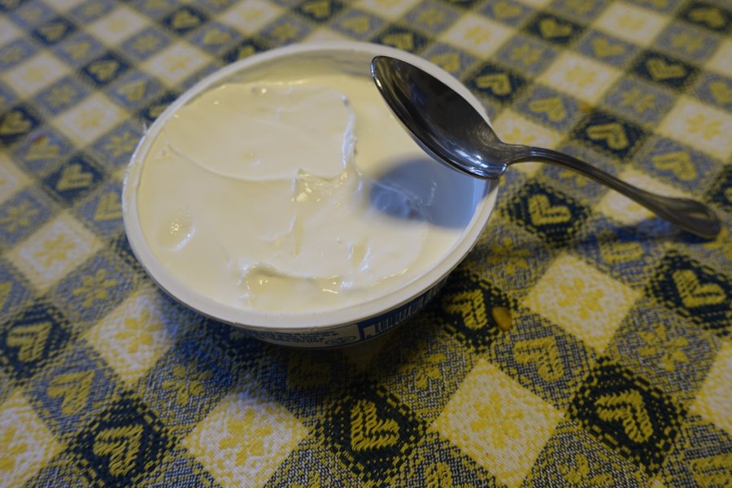
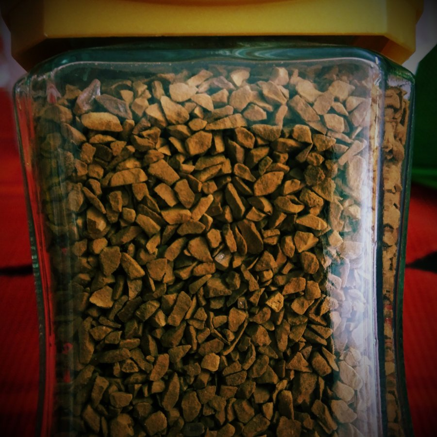
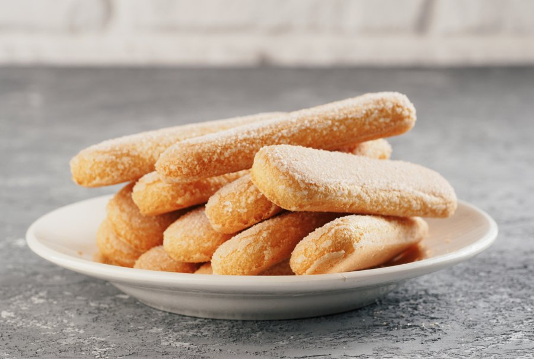
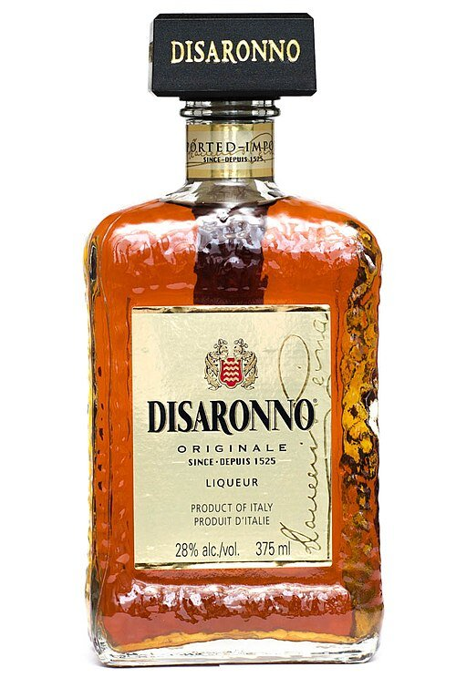
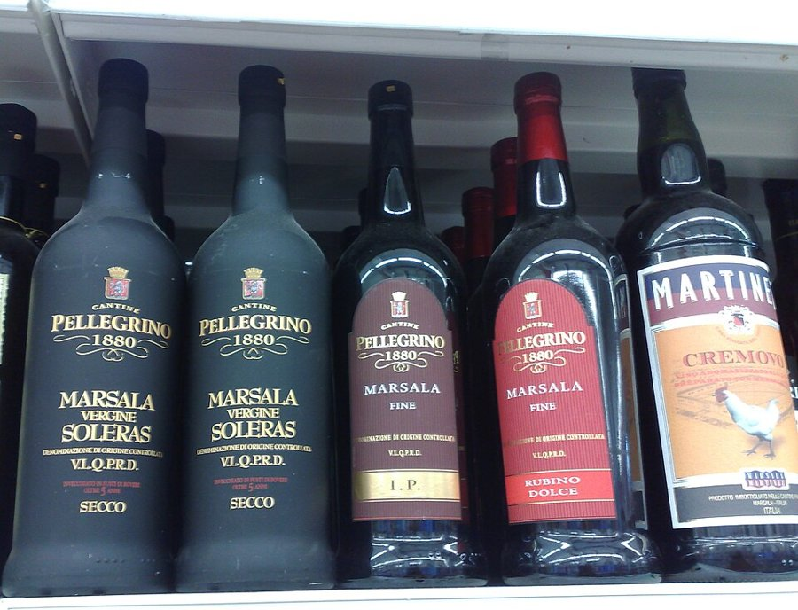
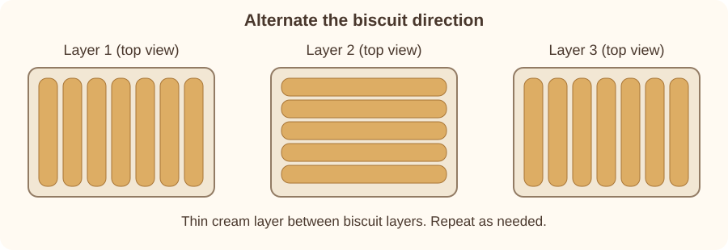

# Davide's Tiramisu

Davide's ricotta and mascarpone tiramisu with strong coffee, savoiardi, and Disaronno or Marsala. Includes ingredient reference photos and a biscuit-layer diagram.

## Ingredients

- 4 eggs
- 200-250 g ricotta (one package, depending on package size)
- 200-250 g mascarpone (one package, depending on package size)
- 4 tablespoons sugar
- Instant coffee
- Sponge finger biscuits (savoiardi)
- 60 ml (1/4 cup) Disaronno or Marsala liquor
- Cocoa, for dusting
- Shaved dark chocolate, for topping
- Muesli, optional

The source does not specify quantities for the coffee, biscuits, cocoa, or toppings.

## Ingredient Reference Photos

| Ricotta | Mascarpone | Instant coffee |
| --- | --- | --- |
|  |  |  |

| Savoiardi | Disaronno | Marsala |
| --- | --- | --- |
|  |  |  |

Use either Disaronno **or** Marsala. The photos illustrate the ingredients; the brands and packages may differ from those in the original recipe.

## Method

1. Separate the egg whites and yolks into two bowls.
2. Whisk the egg whites until stiff.
3. Whisk the yolks with the sugar.
4. Add the mascarpone, ricotta, and liquor to the yolk-sugar mixture and mix together.
5. Gently combine this mixture with the beaten egg whites, using only a spoon by hand. This is very important.
6. Dissolve the instant coffee in warm water. Make plenty of very strong, bitter coffee, without sugar.
7. Plan alternating layers of biscuits and cream. Change the direction of the biscuits by 90 degrees in each successive biscuit layer, as shown in the diagram below, to give the tiramisu solidity.
8. Dip each biscuit completely into the coffee, one at a time. Dip quickly: the biscuits should be wet, but not too wet. This is very important.
9. Lay the biscuits in a tray or container without squeezing them.
10. Cover the biscuits completely with a thin layer of the cream.
11. Repeat the biscuit and cream layers until the container is full.
12. Sift cocoa over the finished tiramisu.
13. Add shaved dark chocolate and, optionally, some muesli.
14. Refrigerate for at least two hours before serving, so the cream can set.
15. Enjoy.

## Biscuit Layers

The diagram shows the biscuits from above. Spread a thin layer of cream over each biscuit layer, and turn the biscuits 90 degrees for the next layer. Repeat as needed.

## Scaling

Keep the ingredient proportions the same when changing the size. The source gives these examples:

| Size | Eggs | Sugar | Ricotta | Mascarpone |
| --- | --- | --- | --- | --- |
| Smaller | 2 | 2 tablespoons | 1/2 package | 1/2 package |
| Original | 4 | 4 tablespoons | 1 package | 1 package |
| Larger | 6 | 6 tablespoons | 1 1/2 packages | 1 1/2 packages |

Gentle mixing, alternating biscuit directions, and quick coffee dipping are especially important.

## Image Credits

Ingredient photos are from Wikimedia Commons. Local copies are resized and converted to JPEG where needed; their individual licenses apply.

| Photo | Photographer | Source | License |
| --- | --- | --- | --- |
| Ricotta | Schwäbin (Wikimedia) | [Ricotta01.jpg](https://commons.wikimedia.org/wiki/File:Ricotta01.jpg) | [CC BY-SA 3.0 DE](https://creativecommons.org/licenses/by-sa/3.0/de/) |
| Mascarpone | Ramagliolo9 at Italian Wikipedia | [Mascarpone 2.jpg](https://commons.wikimedia.org/wiki/File:Mascarpone_2.jpg) | [CC BY-SA 4.0](https://creativecommons.org/licenses/by-sa/4.0/) |
| Instant coffee | SAM31416 | [Instant Coffee Grains Inside Jar.jpeg](https://commons.wikimedia.org/wiki/File:Instant_Coffee_Grains_Inside_Jar.jpeg) | [CC BY-SA 4.0](https://creativecommons.org/licenses/by-sa/4.0/) |
| Savoiardi | GeoO | [Savoiardikex.png](https://commons.wikimedia.org/wiki/File:Savoiardikex.png) | [CC BY 4.0](https://creativecommons.org/licenses/by/4.0/) |
| Disaronno | Ccyyrree | [Disaronno bottle, 375ml.jpg](https://commons.wikimedia.org/wiki/File:Disaronno_bottle,_375ml.jpg) | [CC0 1.0](https://creativecommons.org/publicdomain/zero/1.0/) |
| Marsala | Dedda71 | [Marsala.jpg](https://commons.wikimedia.org/wiki/File:Marsala.jpg) | [CC BY-SA 3.0](https://creativecommons.org/licenses/by-sa/3.0/) |
